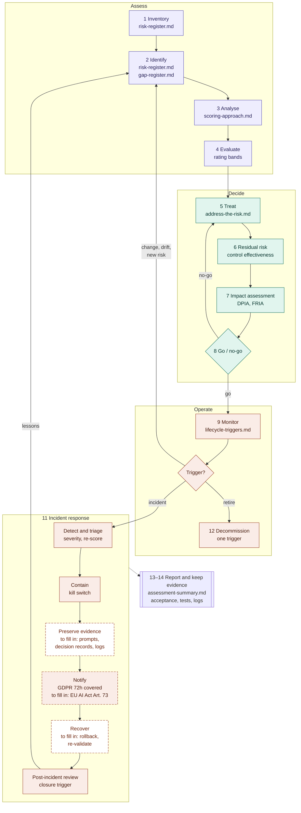

# AI risk register: crosswalk to recognised frameworks

## What this page is for

The AI risk register in this folder is a process: a firm uses it to assess an AI use case against the AIGF risk catalogue, decide what to do about each risk, and decide whether the use case may go live.

None of the steps is new. Each one matches something that recognised frameworks already ask firms to do. This page shows the match, step by step, so that:

- a risk or compliance team can see which requirement each step helps them meet
- a reviewer can check the register against a framework they already know
- contributors can see where the register is complete and where it is thin

The crosswalk maps *steps of the process*. The AIGF risk and mitigation pages map *individual risks* to the same frameworks.

## The process at a glance

Numbers match the steps below. Solid boxes are covered by files in this folder. Dashed boxes are partly covered, or still to fill in.

The incident response stages follow common practice. The [CoSAI AI Incident Response Framework](https://www.coalitionforsecureai.org/wp-content/uploads/2026/03/AI-Incident-Response-1.pdf) ([#271](https://github.com/finos/ai-governance-framework/issues/271)) is a good source for the stages marked "to fill in".

## The steps

| # | Step | What you do | Register files |
|---|---|---|---|
| 1 | Inventory | List the AI use case, its data, models and agents | [risk-register.md](risk-register.md), [lifecycle-triggers.md](lifecycle-triggers.md) (onboarding) |
| 2 | Identify | Pick the AIGF risks that apply, and record any the catalogue does not cover | [risk-register.md](risk-register.md), [gap-register.md](gap-register.md), [stack-coverage.md](stack-coverage.md) |
| 3 | Analyse | Score each risk for likelihood and impact (1 to 5 each) | [scoring-approach.md](scoring-approach.md), [scoring-matrix.md](scoring-matrix.md), [cvss-mapping.md](cvss-mapping.md) |
| 4 | Evaluate | Compare each score with the firm's risk tolerance | [scoring-approach.md](scoring-approach.md) (rating bands) |
| 5 | Treat | Decide to mitigate, transfer, avoid or accept each risk. AIGF mitigations are the catalogue of options for "mitigate" | [address-the-risk.md](address-the-risk.md) |
| 6 | Residual risk | Credit the controls in place, and record the risk that remains | [scoring-approach.md](scoring-approach.md) (control effectiveness) |
| 7 | Assess impact | Run a data protection or fundamental rights impact assessment where the triggers require it | [lifecycle-triggers.md](lifecycle-triggers.md) |
| 8 | Gate | Decide go or no-go, with sign-off at the level the residual risk requires | [scoring-approach.md](scoring-approach.md) (deployment gate) |
| 9 | Monitor and reassess | Watch the system in production, and reassess when a trigger occurs | [lifecycle-triggers.md](lifecycle-triggers.md), [illustrative-benchmark.md](illustrative-benchmark.md) |
| 10 | Stop | Switch off a system that behaves outside its intended use | [address-the-risk.md](address-the-risk.md) (kill switch) |
| 11 | Respond to incidents | Reassess after an incident, and report it where required | [lifecycle-triggers.md](lifecycle-triggers.md) (incident-triggered review) |
| 12 | Decommission | Retire the system safely | [lifecycle-triggers.md](lifecycle-triggers.md) (decommission) |
| 13 | Report | Roll up results for the governance forum | [assessment-summary.md](assessment-summary.md) |
| 14 | Keep evidence | Record who accepted each risk and when, the evidence that controls work, and links to monitoring and decision records | *Not yet in the register; see below* |

## Crosswalk

| # | Step | NIST AI RMF 1.0 | EU AI Act | OSFI E-23 | NIST SP 800-53 r5 | ISO/IEC 42001 * | ISO 31000 * |
|---|---|---|---|---|---|---|---|
| 1 | Inventory | GOVERN 1.6, MAP 1.1 | Art. 26 | 2.1 | — | — | — |
| 2 | Identify | MAP 4.1, MEASURE 3.1 | Art. 9 | 3.1 | RA-3 | 6.1.2, 8.2 | 6.4.2 |
| 3 | Analyse | MAP 5.1, MEASURE 1.1 | Art. 9 | 2.2 | RA-3 | 6.1.2, 8.2 | 6.4.3 |
| 4 | Evaluate | GOVERN 1.3, MANAGE 1.2 | Art. 9 | 1.2, 2.3 | PM-9 | 6.1.2 | 6.4.4 |
| 5 | Treat | MANAGE 1.3 | Art. 9 | 3.1 | RA-7 | 6.1.3, 8.3 | 6.5 |
| 6 | Residual risk | MANAGE 1.4 | Art. 9 | 2.2 | CA-2, CA-5 | 6.1.3 | 6.5 |
| 7 | Assess impact | MAP 1.1, MAP 5.1 | Art. 27 | — | RA-8 | 6.1.4, 8.4, A.5.2 | — |
| 8 | Gate | MANAGE 1.1 | Art. 9 | 3.5 | CA-6 | 8.3 | 6.4.4 |
| 9 | Monitor and reassess | MANAGE 4.1, MEASURE 2.4, GOVERN 1.5 | Art. 72 | 3.6 | CA-7, RA-3 | 9.1, A.6.2.6 | 6.6 |
| 10 | Stop | MANAGE 2.4 | Art. 14 | 3.6 | — | — | — |
| 11 | Respond to incidents | MANAGE 4.3 | Art. 73 | — | IR-4 | 10.2 | — |
| 12 | Decommission | GOVERN 1.7 | — | 3.6 | — | — | — |
| 13 | Report | GOVERN 1.4 | — | 1.1 | PM-9 | 9.3 | 6.7 |
| 14 | Keep evidence | MANAGE 1.4, MANAGE 4.3 | Art. 12, Art. 73 | 3.6 | AU-6, CA-2 | 7.5 | 6.7 |

\* ISO/IEC 42001 clauses 6 to 10 and ISO 31000 are not yet in the AIGF reference data, and their text is not freely available. Check these numbers against the standards before relying on them. The other columns use entries that AIGF already references, except the NIST AI RMF (see below).

### Notes on the columns

- **NIST AI RMF 1.0 (NIST AI 100-1).** The AI RMF describes a risk management *process* in four functions: GOVERN, MAP, MEASURE and MANAGE. That is why it fits this register better than it fits individual risks. Subcategory IDs and wording were checked against [NIST AI 100-1](https://nvlpubs.nist.gov/nistpubs/ai/NIST.AI.100-1.pdf). For example, MANAGE 1.1 is the decision "whether its development or deployment should proceed", and MANAGE 2.4 covers mechanisms "to supersede, disengage, or deactivate AI systems".
- **EU AI Act.** Articles 9 (risk management system), 14 (human oversight), 27 (fundamental rights impact assessment), 72 (post-market monitoring) and 73 (serious incidents) apply to high-risk systems. Article 26 sets obligations for deployers.
- **OSFI E-23 (2027).** Numbers are E-23 principles, for example 2.1 "Model Inventory and Tracking" and 3.6 "Monitoring and Decommissioning Standards". Similar expectations appear in PRA SS1/23 in the UK and SR 26-2 in the US.
- **NIST SP 800-53 Rev. 5.** Control IDs from the RA (risk assessment), CA (assessment, authorization and monitoring), PM (program management) and IR (incident response) families. CA-7 is Continuous Monitoring; the AIGF reference data currently mistitles it "Authorization" (#417). The existing [nist-rmf-mapping.md](nist-rmf-mapping.md) shows how the register's scores map onto the SP 800-30 / SP 800-37 risk management framework that these controls belong to.

## What the crosswalk shows

- **Every step has at least two recognised anchors.** The register is not a new method. It is a practical way to carry out what these frameworks ask for, using the AIGF catalogue.
- **The AI RMF covers every step.** It is the most complete single match, and it is written for AI rather than for IT systems in general.
- **Strengths beyond the basics:** the kill switch (step 10) and incident-triggered review (step 11) are well developed. They match MANAGE 2.4 and MANAGE 4.3, and the kill switch matches EU AI Act Article 14, which many internal processes leave out.
- **Incident response gaps:** preserving evidence and recovery are not yet covered, and notification covers GDPR but not serious-incident reporting under EU AI Act Article 73. The diagram above marks these with dashed boxes.
- **Evidence (step 14) is the main gap.** The register records each risk and its scores, but not who accepted it and when, the evidence behind each control effectiveness rating, or links to monitoring and decision records (mi-4, mi-9, mi-21). An incident review or an Article 73 report needs all of these. `address-the-risk.md` already asks for the acceptance date and approver, so adding them to each register entry would close most of the gap.
- **Thin spot:** decommissioning (step 12) has a single trigger. GOVERN 1.7 asks for systems to be phased out "in a manner that does not increase risks", and OSFI E-23 3.6 sets decommissioning standards. This is a good candidate for the next iteration.
